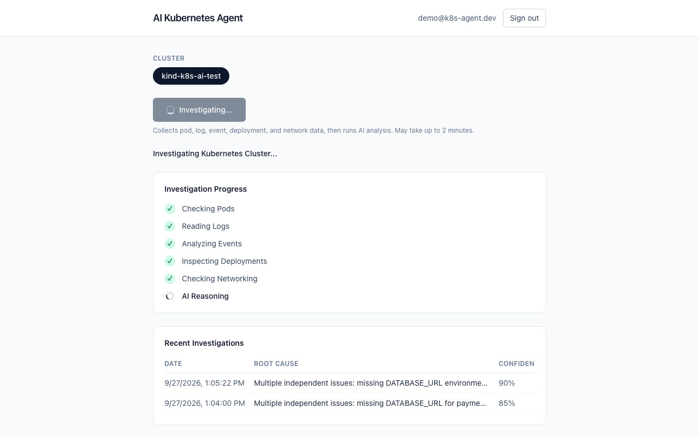
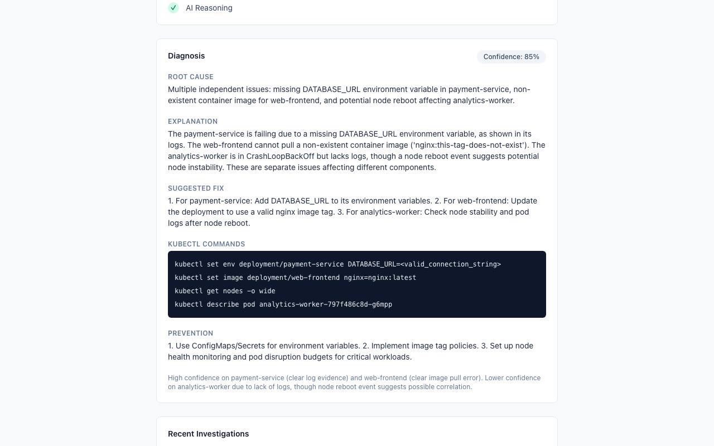
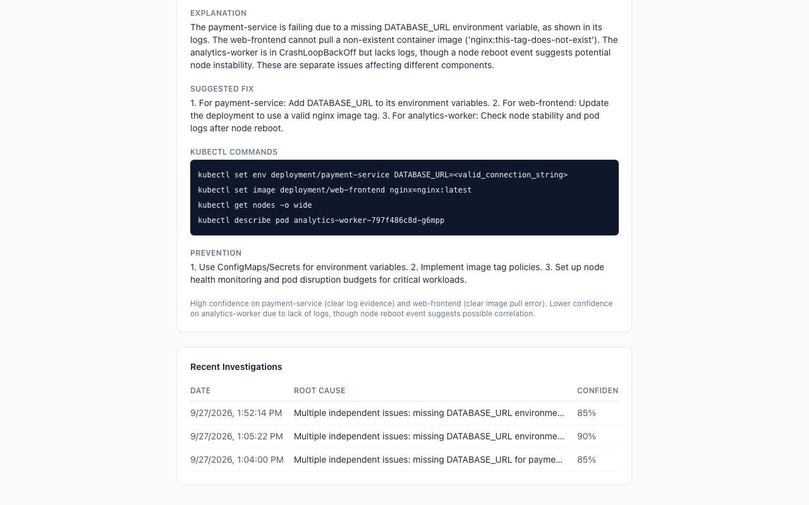
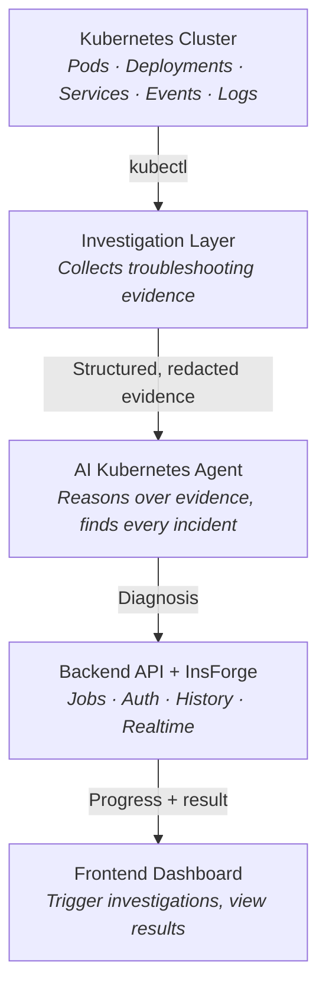
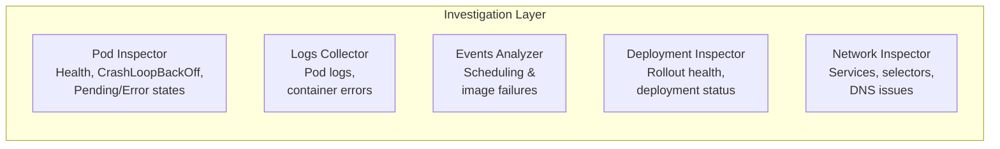
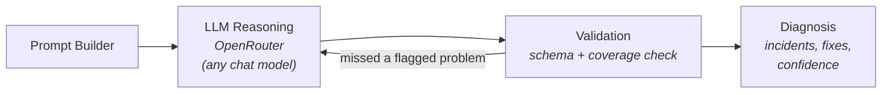
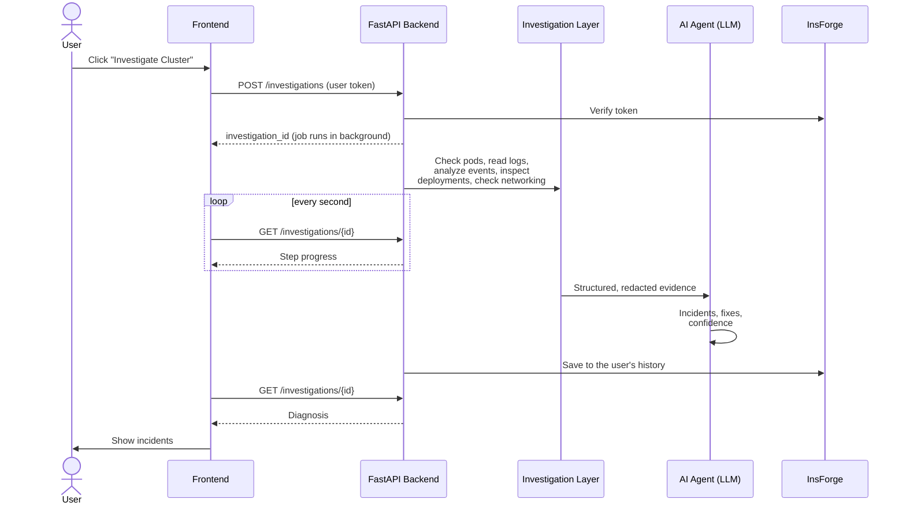
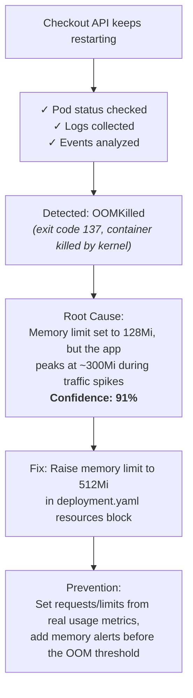

# AI Kubernetes Troubleshooting Agent

[](https://github.com/mohammedfirdouss/k8s-ai-agent/actions/workflows/ci.yml)

An AI-powered platform that investigates Kubernetes failures, analyzes logs, events, and cluster state, identifies root causes, and suggests fixes with full investigation history and a public web dashboard.

## Demo

https://github.com/user-attachments/assets/28e9d330-4219-420e-bcb6-130cb9be881c







## What It Does

- **Investigates** a cluster on demand: pods, logs, recent warning events, deployments and services
- **Reports every independent problem** as its own incident, most severe first, with the evidence it rests on
- **Suggests fixes** as kubectl commands, plus how to prevent the problem from coming back
- **Scores confidence** from how direct the evidence is, and says so when the cause can't be determined
- **Keeps a private history** for each user, with 👍/👎 feedback on every diagnosis
- **Is measured**: an eval harness scores diagnoses against 11 recorded failure scenarios

## High-Level Architecture

The system is made of five layers. Evidence flows up from the cluster, gets analyzed by the AI agent, and results are stored and displayed to the user.



## Layer Breakdown

### 1. Investigation Layer

Connects to the cluster and gathers debugging evidence through five inspectors:



### 2. AI Kubernetes Agent

Turns raw evidence into a diagnosis:



| Component | Responsibility |
| --- | --- |
| Prompt Builder | Turns the evidence into a structured prompt (secrets in logs and events are redacted first) |
| LLM Reasoning | Correlates the evidence into incidents through OpenRouter, so any chat model works |
| Validation | Checks the reply against a schema, and checks that every problem the inspectors flagged is covered; otherwise asks again once |
| Agent tools *(experimental, off by default)* | Lets the model run read-only kubectl tools (`describe`, `get_yaml`, `list`, `logs`) to dig deeper |

### 3. Backend API and InsForge

The FastAPI backend runs each investigation as a background job and reports progress step by step. [InsForge](https://insforge.dev) provides:

| Component | Responsibility |
| --- | --- |
| Authentication | Email/password sign-in; the backend verifies the user's token on every request |
| Investigation History | Each user's past diagnoses and feedback, protected by row-level security (users read only their own rows) |
| Realtime | A per-user channel that refreshes the history list when a new investigation is saved |

### 4. Frontend Dashboard

Lets users pick a cluster, start an investigation, and watch its progress (a page refresh resumes it). They can then read each incident with its evidence and copyable kubectl commands, rate the diagnosis, and open past investigations from their history.

### 5. Deployment

Both services ship as Docker images (`docker compose up --build`). The backend needs `kubectl` access to the target cluster through a kubeconfig.

## End-to-End Workflow



## Example Investigation

**Issue:** Checkout API keeps restarting under load



## Supported Kubernetes Problems

| Category | Problems |
| --- | --- |
| **Pod failures** | CrashLoopBackOff · ImagePullBackOff · OOMKilled · CreateContainerConfigError (e.g. missing ConfigMap) · stuck init containers · restart loops |
| **Scheduling** | Pending pods (e.g. insufficient CPU/memory) |
| **Deployments** | Unavailable replicas · failed rollout conditions |
| **Networking** | Services with no ready endpoints (selector mismatch, unready pods) · cluster DNS down |
| **Health checks** | Readiness and liveness probe failures |

Each row is backed by an eval scenario in [`k8s-test-scenarios/`](k8s-test-scenarios). The scenarios also include a crash with no logs, which tests that confidence drops when the cause can't be known, and a healthy cluster, which tests for false alarms. With `deepseek/deepseek-chat`, every run that got an answer from the model was correct (single-shot, 3 runs per scenario). See [backend/README.md](backend/README.md#evals) to run the evals.

## Tech Stack

- **Backend:** FastAPI, Python 3.12, Uvicorn, Pydantic, Loguru, HTTPX
- **Frontend:** Next.js 15, TypeScript, Tailwind CSS, Axios, React Query
- **AI:** OpenRouter (any chat model, e.g. Claude, GPT, DeepSeek)
- **Platform:** InsForge (auth, Postgres with row-level security, realtime)
- **Quality:** pytest, recorded-fixture evals, GitHub Actions CI
- **Cluster access:** kubectl / Kubernetes API
- **Infrastructure:** Docker, Docker Compose

## Project Structure

```text
k8s-ai-agent/
├── backend/            # FastAPI orchestration service
│   └── app/
│       ├── api/        # HTTP routes (health, investigations)
│       ├── core/       # Configuration and settings
│       ├── kubernetes/ # Cluster inspectors (pods, logs, events, ...)
│       ├── ai/         # Prompt building and LLM reasoning
│       ├── services/   # Investigation orchestration
│       └── models/     # Pydantic schemas
├── frontend/           # Next.js dashboard
│   └── src/
│       ├── app/        # Pages and layout
│       ├── components/ # UI components
│       ├── services/   # API client
│       ├── hooks/      # React Query hooks
│       └── types/      # TypeScript interfaces
├── docs/               # Additional documentation
└── docker-compose.yml
```

## Getting Started

### Prerequisites

- Docker and Docker Compose (for the containerized setup), or
- Python 3.12+ and Node.js 20+ (for local development)

### Run with Docker (recommended)

```bash
docker compose up --build
```

- Frontend: <http://localhost:3000>
- Backend health check: <http://localhost:8000/health>

### Run locally without Docker

Backend:

```bash
cd backend
python3 -m venv .venv && source .venv/bin/activate
pip install -r requirements.txt
uvicorn app.main:app --reload --port 8000
```

Frontend (in a second terminal):

```bash
cd frontend
npm install
cp .env.example .env.local   # points the UI at http://localhost:8000
npm run dev
```

### Configuration

Copy `backend/.env.example` to `backend/.env` and fill in the values when you are ready to enable AI analysis and cluster access:

```env
OPENROUTER_API_KEY=   # LLM access via OpenRouter
OPENROUTER_MODEL=     # e.g. a Claude, GPT, or DeepSeek model id
KUBECONFIG_PATH=      # path to the kubeconfig of the target cluster
```

The backend `.env` is optional — without an OpenRouter key the app still gathers evidence and reports that AI analysis is disabled.

For login and investigation history, create an [InsForge](https://insforge.dev) project, apply the SQL in `migrations/` (`npx -y @insforge/cli db migrations up --all`), and set:

```env
# frontend/.env.local
NEXT_PUBLIC_INSFORGE_BASE_URL=   # your InsForge backend URL
NEXT_PUBLIC_INSFORGE_ANON_KEY=   # the project's anon key

# backend/.env
INSFORGE_URL=                    # same InsForge URL — turns on API authentication
INSFORGE_API_KEY=                # admin key, server-side only — saves history
```

With `INSFORGE_URL` set, the backend rejects requests without a valid signed-in user token, and each user only sees their own investigation history. Without these variables the app runs in a local, single-user, no-login mode — don't expose the backend to a network in that mode.

See [backend/README.md](backend/README.md) and [frontend/README.md](frontend/README.md) for service-specific details.
