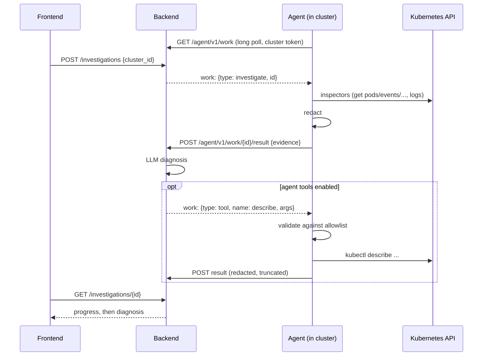

# Design: connecting real clusters with an in-cluster agent

Status: proposed · 2026-10-11 · updated 2026-11-18

## Problem

Today the backend runs `kubectl` with the kubeconfig of the machine it runs
on. That works for a developer running everything locally, but a hosted
deployment cannot reach users' clusters: they sit behind firewalls, and
asking users to upload a kubeconfig hands us standing credentials to their
cluster, which security-minded teams will refuse.

## Decision

Users install a small **agent** in each cluster. The agent:

- runs with a **read-only ServiceAccount** (no Secrets, no writes)
- makes **outbound HTTPS connections only**: no inbound port, no exposed API server
- collects and **redacts evidence inside the cluster**, so raw logs never leave it unredacted
- runs only **typed, allowlisted requests** from the backend, never arbitrary commands

This is the model used by Komodor, Robusta and the k8sgpt operator.

Alternatives considered:

| Option | Why not (as the primary path) |
| --- | --- |
| Upload a kubeconfig | Standing credentials stored by us; usually admin-level; a breach exposes every customer cluster |
| Local CLI using the user's kubeconfig | Good for individuals, but no history or sharing unless it also talks to the backend; no team or always-on use. Worth adding later as a second client of the same API |
| Backend connects inbound to the API server | Requires exposing the API server; non-starter behind private networks |

## How it fits the current code

The existing `Kubectl` abstraction is the seam. Inspectors already call only
`kube.run(...)` / `kube.run_json(...)`, and the evals already swap in
`RecordingKubectl` / `ReplayKubectl`. The agent reuses the inspectors
unchanged. Inside a pod, `kubectl` picks up the ServiceAccount token
automatically, so `Kubectl()` works in-cluster with no code change.

### Why long polling

The agent keeps one `GET /agent/v1/work?wait=25` open and re-opens it when it
returns. This works through corporate proxies and needs no new
infrastructure (FastAPI handles it). The lowest latency to start work is
"immediately", since the open request is answered as soon as work arrives.
WebSockets can come later if fan-out demands it.

## Components

### Agent (`agent/`)

- Entrypoint `python -m agent`. It reuses `app/kubernetes` (inspectors,
  kubectl runner, redaction) and the tool allowlist in `app/ai/tools.py`
  through a shared package, so there is one implementation.
- Its own slim image: Python, `kubectl`, `httpx`, `loguru`. No FastAPI and no LLM code:
  the AI provider SDK and its API key stay on the backend and never enter the cluster.
- Config: `BACKEND_URL`, `CLUSTER_TOKEN` (from a Secret), optional
  `NAMESPACES` allowlist.
- Validates every request locally:
  - `investigate`: runs the fixed inspector command set.
  - `tool`: rebuilt with `command_for()`. Anything else is rejected.
  - It never accepts a raw command string.
- Truncates outputs and caps payload size (e.g. 1 MB) before sending.
- Heartbeat: every poll updates the cluster's `last_seen`.

### RBAC (read-only)

From the commands the inspectors and tools issue today:

| API group | Resources | Verbs |
| --- | --- | --- |
| core | pods, pods/log, events, services, endpoints, nodes | get, list |
| apps | deployments, replicasets, statefulsets, daemonsets | get, list |
| batch | jobs, cronjobs | get, list |
| networking.k8s.io | ingresses, networkpolicies | get, list |
| autoscaling | horizontalpodautoscalers | get, list |
| core | persistentvolumeclaims | get, list |

The default excludes **Secrets** (never requested) and **ConfigMaps**
(optional: their contents can hold credentials). The missing-ConfigMap
scenario is still diagnosed from the pod's waiting message and events.
The agent tool allowlist (`app/ai/tools.py`) does include `configmap`.
Without the opt-in, those tool calls get a clean permission error, which the
model handles like any other failed tool call.

The default is a ClusterRole. A namespace-scoped install (a Role per
namespace plus a `NAMESPACES` allowlist) is phase 4, for teams that can't
grant cluster-wide read.

### Backend

- **Cluster registry** (InsForge table `clusters`): `id`, `user_id`,
  `name`, `token_hash` (SHA-256; the token is shown once), `created_at`,
  `last_seen`, `agent_version`. RLS: owners read their own rows; writes go
  through the backend only.
- **User API**: `POST /clusters` (returns the token and the install
  command), `GET /clusters` (with online/offline status from `last_seen`),
  `DELETE /clusters/{id}` (revokes the token).
- **Agent API** (`/agent/v1/...`, authenticated by cluster token, not a
  user token): `GET work`, `POST work/{id}/result`. Strict size limits and
  per-token rate limits.
- **Execution target**: `jobs.py` picks where to collect evidence:
  - a local kubeconfig context (today's behaviour; kept for development and the evals)
  - a connected cluster: the job is queued for that cluster's agent and
    waits for the result, with a timeout when the agent is offline
- **Tool calls** go through a `RemoteKubectl` that enqueues one `tool` work
  item and awaits its result, so `analyze()` stays unchanged.
  - **Worth supporting:** in the 2026-11-18 eval (Claude Haiku 5.5), tool use
    let the model read a pod's YAML and find the real cause of a crash that
    leaves no logs, which the standard evidence cannot show.
  - **Cost of each call:** one round trip through the agent's long poll. The
    same eval averaged 0–2 tool calls per diagnosis, so expect a few extra
    seconds, not minutes.

### Frontend

- The cluster picker lists **connected clusters** with an online dot, plus
  local contexts in local mode.
- A **Connect a cluster** flow: name it, get a one-line install command
  (`kubectl apply -f <url>` with the token as a Secret), then watch it come online.
- Per-cluster actions: rename, rotate token, disconnect.

### Install manifest (`deploy/agent/`)

Plain YAML first: Namespace, ServiceAccount, ClusterRole and binding,
Secret (token), and a Deployment with 1 replica, resource limits and a
non-root, read-only root filesystem. Add a Helm chart once the manifest is stable.

## Security notes

- **A compromised backend** can at most read what the RBAC allows. It
  cannot write, exec, or read Secrets, because the agent rejects
  non-allowlisted requests and the ServiceAccount can't do it either.
- **A leaked cluster token** lets someone impersonate that agent (submit
  fake evidence, receive work). It never grants cluster access. Rotate
  and revoke from the UI; tokens are stored hashed.
- **Redaction happens before egress.** The backend redacts again
  (defence in depth).
- **Evidence goes to a third-party AI provider.** The backend sends the
  redacted evidence (and any tool outputs) to the configured LLM provider:
  Anthropic's API by default (`LLM_PROVIDER=anthropic`), or OpenRouter.
  The install docs must say so, so teams can check this against their
  data-handling rules before connecting a cluster.
- **Payload caps** stop a misbehaving agent from flooding the backend.

## Phases

| Phase | Scope | Done when |
| --- | --- | --- |
| 1. Shared core and agent | Move inspectors, redaction and the tool allowlist into a package both sides import. Agent process, long-poll client, request validation. Agent image | The agent runs against the kind cluster and its evidence matches what the backend collects locally |
| 2. Backend registry and agent API | `clusters` table and migration, token issuing and hashing, `/agent/v1` endpoints, execution target, `RemoteKubectl` | An investigation of a connected cluster completes end to end; tests cover auth, revocation, timeouts and payload limits |
| 3. Install and UI | `deploy/agent/` manifests; connect flow, online status and token rotation in the frontend | A fresh kind cluster is connected from the UI in under 2 minutes |
| 4. Hardening | Namespace-scoped mode, per-token rate limits, agent version reporting, Helm chart | — |

The evals keep running against fixtures, because they use the `Kubectl`
seam directly. Phase 1 adds one test: the agent's evidence for a fixture
matches the backend's.

## Open questions

1. **Where is the backend hosted?** Agents need a public HTTPS URL to
   reach. Options: InsForge compute, Fly/Render, or a VM. This doesn't
   block phases 1–2, which run locally against kind.
2. **ConfigMap read: off by default?** Recommended: off, with an opt-in
   flag in the manifest.
3. **Jobs and work queue state** are in memory today, so the backend has
   to run as a single instance. That's fine for now; move them to
   Postgres (or Redis) before running more than one backend replica.
